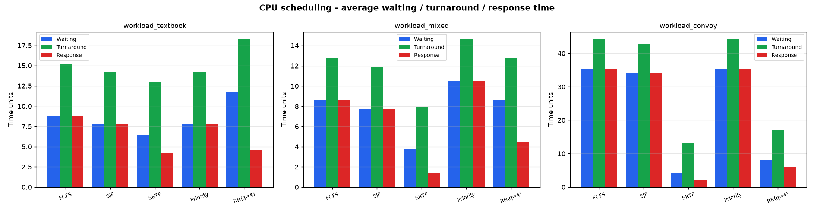
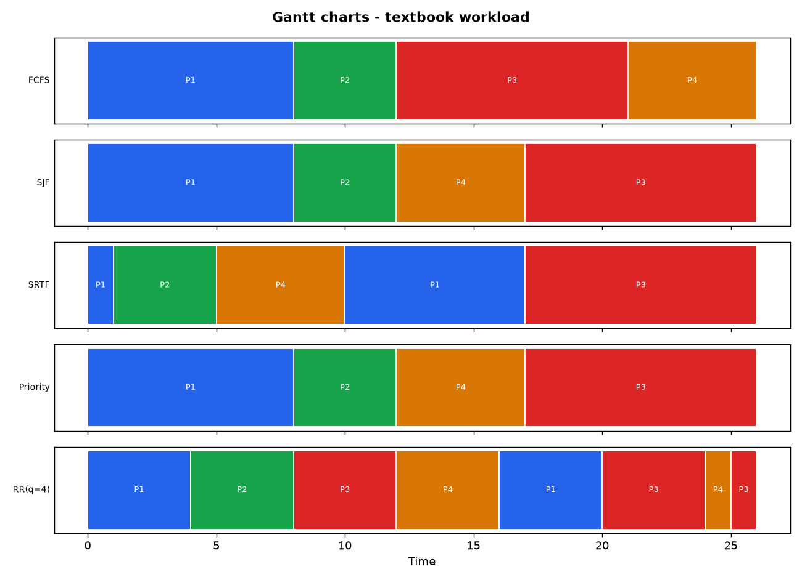
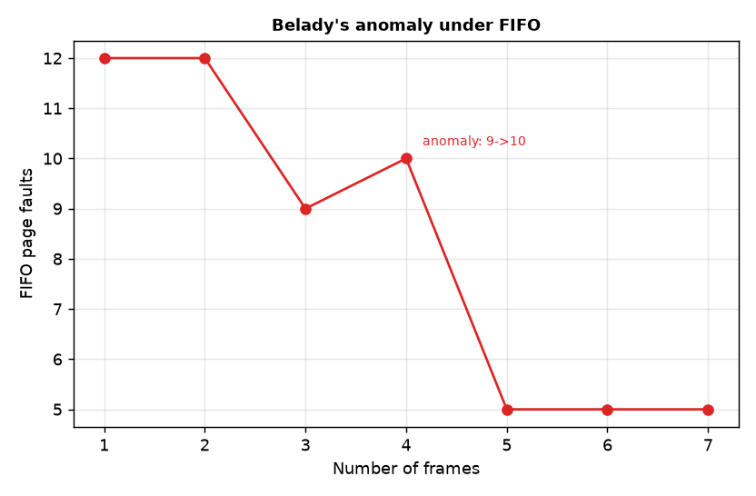
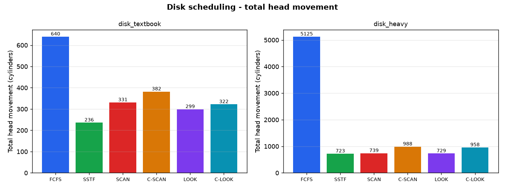

# 1. Problem and scope (Phase 1)

Operating systems must share a few scarce resources - CPU time, memory frames, resource
instances and disk bandwidth - among competing programs. This project builds **one
application** that simulates those decisions, runs the algorithms on common datasets and
reports measurable differences between them.

**Architecture.** A menu (`main.py`) calls five modules through a shared input-validation
layer, a shared logger and a shared set of data models:

| Module | Algorithms | Key outputs |
|---|---|---|
| Scheduler | FCFS, SJF, SRTF, Priority, RR | Gantt, waiting / turnaround / response, CPU utilisation, throughput, context switches |
| Memory | FIFO, LRU, OPT, Clock; first / best / worst fit | faults, hit ratio, Belady check, fragmentation |
| Deadlock | Banker's algorithm, detection | safe sequence, grant/deny with reason, deadlocked set |
| Storage | FCFS, SSTF, SCAN, C-SCAN, LOOK, C-LOOK | head path, total movement |
| Reporting | tables, CSV, charts | `outputs/` |

**Workflow.** `file/menu input -> validators -> module -> result objects -> reporting -> traces, CSV, charts`;
every step appends to `logs/activity.log`.
**Data design.** `Process`, `ScheduleResult`, `PageResult`, `DiskResult` dataclasses; plain CSV/TXT/JSON inputs.
**Bash integration.** `sysinfo.sh` (host CPU/memory/disk snapshot), `log_summary.sh` (grep/awk analysis of the
activity log), `generate_workload.sh` (seeded random workloads), `run_tests.sh` and the `run.sh` launcher.
Python calls them via `subprocess`, parses `key=value` output and converts script failures into `BashToolError`.

# 2. Implementation (Phase 2)

Four major OS modules are implemented (the brief requires three) with reusable functions
and classes (e.g. `Allocator`, `simulate_pages`, `is_safe`). The code was verified against
well-known textbook results: SRTF average wait 6.5 (FCFS 8.75, SJF 7.75), page faults
FIFO/LRU/OPT = 15/12/9, Banker safe sequence P1,P3,P4,P0,P2, and disk head movement
640/236/331/382/299/322 - all reproduced exactly.

# 3. Analysis and comparison (Phase 3)

Each algorithm family was run on three or more datasets (`data/`).

## 3.1 CPU scheduling

{width=100%}

| Dataset | FCFS | SJF | SRTF | Priority | RR (q=4) |
|---|---|---|---|---|---|
| Textbook - avg waiting | 8.75 | 7.75 | **6.50** | 7.75 | 11.75 |
| Mixed - avg waiting | 8.62 | 7.75 | **3.75** | 10.50 | 8.62 |
| Convoy - avg waiting | 35.33 | 34.00 | **4.17** | 35.33 | 8.17 |
| Convoy - avg response | 35.33 | 34.00 | **2.00** | 35.33 | 6.00 |

* SRTF minimises waiting on every dataset, at the price of more context switches (8 vs 7 on the mixed set)
  and the risk of starving long jobs.
* The **convoy** dataset shows why FCFS is poor for mixed workloads: one 40-unit job makes five short jobs
  wait 35 units on average, while Round Robin cuts it to 8.17 because every job keeps getting CPU slices.
* Round Robin has the best response among non-SRTF policies but the worst turnaround on the textbook set,
  because time slicing delays completion.
* Priority is only as good as the priorities assigned: on the mixed set it was worse than FCFS (10.5 vs 8.62).
* The mixed dataset contains an idle gap, so CPU utilisation is 97.06% rather than 100%.

{width=90%}

## 3.2 Memory management

| Reference set (3 frames) | FIFO | LRU | OPT | Clock |
|---|---|---|---|---|
| Textbook (20 refs) | 15 | 12 | **9** | 14 |
| Belady string (12 refs) | 9 | 10 | **7** | 9 |
| Locality string (36 refs) | 26 | 20 | **17** | 26 |

* OPT is the lower bound; LRU is closest to it when the program has locality (20 vs 26 for FIFO).
* **Belady's anomaly** is reproduced: FIFO faults rise from 9 (3 frames) to 10 (4 frames);
  the 1-7 frame sweep is 12, 12, 9, 10, 5, 5, 5.

{width=60%}

* Contiguous allocation on `alloc_ops.txt` (1000 units): first-fit and worst-fit each failed one request
  (18.46% external fragmentation); best-fit failed two and left 48.39% fragmentation because it creates many
  tiny unusable holes. This is one sequence, not a general ranking.

## 3.3 Deadlock handling

Requests are processed in order against the textbook state: **P1 (1,0,2) granted** (safe sequence
P1,P3,P4,P0,P2); **P4 (3,3,0) denied** - resources unavailable; **P0 (0,2,0) denied** - would leave an unsafe
state; **P2 (6,0,0) denied** - must wait. The detection algorithm reports no deadlock for `deadlock_none.json`
and **P1-P4 deadlocked** when P2 needs one more resource C (`deadlock_present.json`).

## 3.4 Storage (disk scheduling)

{width=100%}

| Dataset | FCFS | SSTF | SCAN | C-SCAN | LOOK | C-LOOK |
|---|---|---|---|---|---|---|
| Textbook (8 requests) | 640 | **236** | 331 | 382 | 299 | 322 |
| Heavy (20 requests) | 5125 | **723** | 739 | 988 | 729 | 958 |

SSTF moves least but can starve distant requests; LOOK/SCAN are close behind with bounded waiting.
LOOK beats SCAN because it turns at the last request instead of the disk edge. The numbers for C-SCAN/C-LOOK include the
return jump, which explains their higher totals.

# 4. Testing and reliability (Phase 4)

63 automated tests (`./run.sh tests`, all passing) cover **valid**, **invalid** and **boundary** inputs:

| Area | Valid | Boundary | Invalid |
|---|---|---|---|
| Scheduling | textbook averages, CPU-time conservation | single process, idle gap, quantum > bursts | empty workload, burst 0, negative arrival, duplicate PID, quantum 0, unknown algorithm |
| Memory | 15/12/9 faults, Belady, coalescing | 1 frame, frames >= distinct pages, exact-fit hole | 0 frames, empty string, free of unknown block, duplicate allocation |
| Deadlock | safe sequence, grant | zero request | request > need, bad PID, ragged matrix, allocation > max |
| Storage | six known totals | head at 0 / last cylinder, 2-cylinder disk | head or request out of range, empty list, bad direction |
| Files / CLI / Bash | valid CSV, reproducible workload | EOF on stdin | missing / empty / malformed files, bad JSON, bad menu option, bad script arguments |

**Reliability features.** Central validation; custom exceptions shown as `[ERROR] ...` without leaving the menu;
unexpected errors are logged with a traceback; EOF/Ctrl-C exit cleanly; Bash failures become `BashToolError`;
all activity (including warnings for denied requests and failed allocations) is logged and summarised by
`log_summary.sh`. Evidence: `outputs/traces/test_results.txt`, `error_handling_session.txt`, `logs/activity.log`.

# 5. Documentation and demonstration (Phase 5)

* **Run it:** see `README.md` (`./run.sh demo` reproduces every result in this report).
* **Evidence:** `outputs/traces/` (full execution traces), `outputs/charts/` (9 charts), `outputs/results_*.csv`,
  `outputs/screenshots/` (8 terminal captures rendered from real output).
* **Suggested demonstration order (5 min):** menu -> option 1 on the convoy workload (FCFS vs SRTF) -> option 2
  Belady string -> option 4 Banker requests -> option 5 disk -> option 7 Bash tools -> `./run.sh tests`.
* **Originality:** the four modules share one validation layer, logger, data models and reporting pipeline, and
  Bash scripts are called from Python to supply workloads, host context and log analytics - it is one system, not
  four separate programs.
* **Limitations:** single-CPU, time-unit simulation (no real preemption or I/O); contiguous allocation has no
  compaction; disk service time ignores rotational latency. These are natural extensions.
